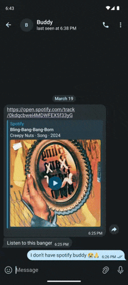
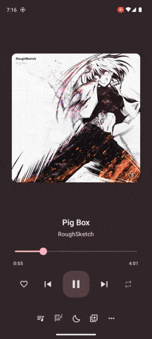
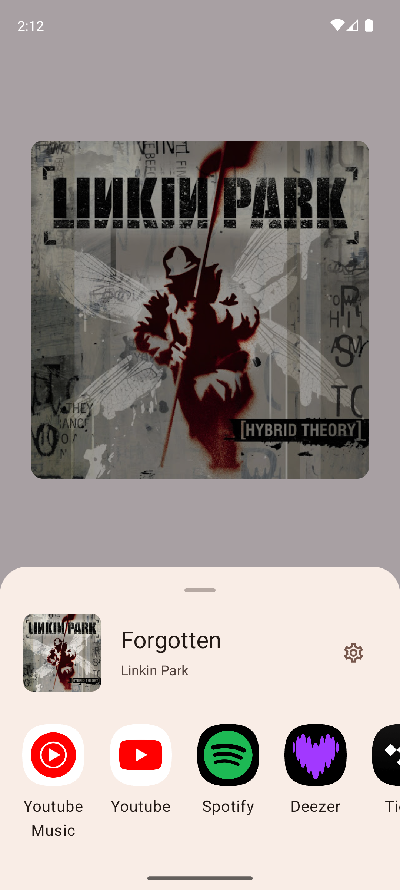
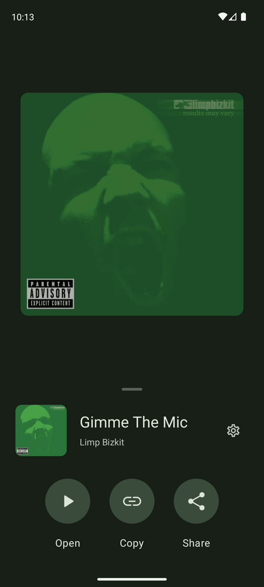
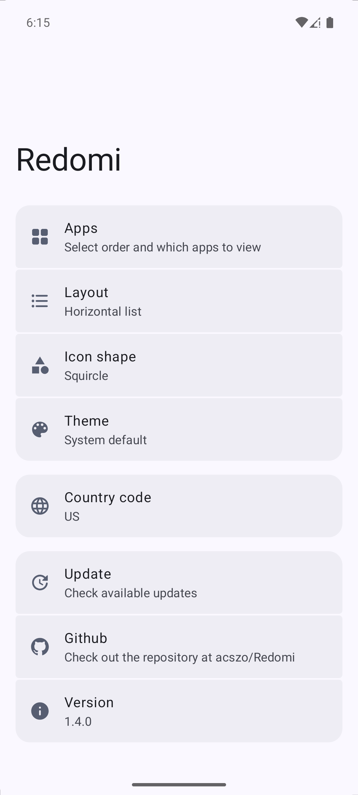
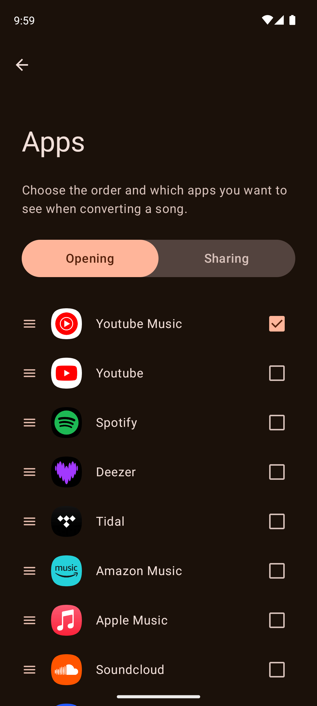
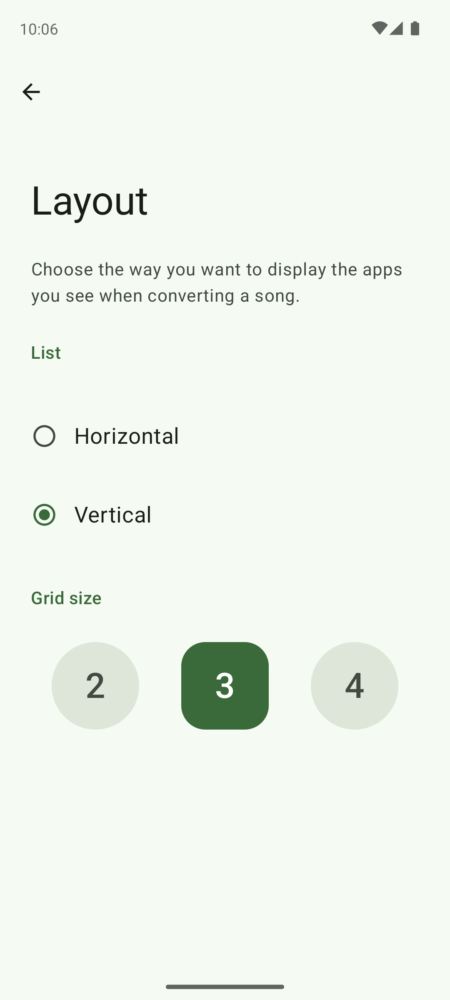
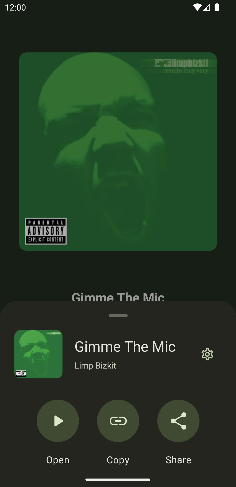

<div align="center">
  
  <h1>Redomi</h1>
  <p>Unofficial <a href="https://song.link/">song.link</a> client made in Jetpack Compose and Material You</p>
  
  
  [](https://github.com/acszo/Redomi/releases/latest/)
  [](https://crowdin.com/project/redomi)

  [](https://github.com/acszo/Redomi/releases/latest)
  [](https://f-droid.org/en/packages/com.acszo.redomi.repo)
  [](https://apt.izzysoft.de/fdroid/index/apk/com.acszo.redomi.repo)
  
</div>

## Description

Don't you hate when you receive music links from friends who use different platforms than you, and you can't tap and play them in your favourite music service???? <br/>
This app is here to solve that problem! <br/>
And you can also share the songs you want to anyone by converting the link to their preferred platform. <br/> <br/>
<b> All of this is done like it's integrated into your system! </b>

## Features

- Open supported links from different music services in your favourite streaming app
- Convert links and share songs with others on their preferred platforms
- Customize Sharesheet in different ways:
  - Icon shapes
  - Choose which apps to display
  - Decide between a horizontal or vertical list, and its grid size
- Material You
- Light/Dark Theme

## In action 😎

<p align="center">
  
  
</p>

## Screenshots

<p align="center">
  
  
  
  
  
  
</p>

## HOW TO MAKE IT WORK (on Android 12+)

By default Redomi is unable to open links, do as follows:
1. Long-press on Redomi and open its info page
2. Navigate to "Set/Open by default" (this may have a different naming on some devices)
3. Check all the music platforms that are *NOT* installed

## Supported services (+ 3rd party apps)

- Youtube music
- Youtube
- Spotify
- Deezer
- Tidal
- Amazon Music
- Apple Music
- Soundcloud
- Napster
- Yandex Music
- Anghami
- Qobuz

3rd party clients are also compatible, as long as they're the default app to handle the corresponding link

## Qobuz

Qobuz is available in both the opening and sharing app lists. Existing installations
with a saved selection must enable it in **Settings > Apps**. To open received music
links directly in Qobuz, select only Qobuz in the opening list. Leave Qobuz domains
unchecked in Android's Redomi link settings when the Qobuz app is installed, so
outgoing Qobuz links are handled by Qobuz rather than Redomi.

Supported inputs are track and album links from `open.qobuz.com` and
`play.qobuz.com`, and localized store album URLs such as
`www.qobuz.com/fr-fr/album/title/album-id`. Share text containing a link is also
supported. Playlists and artist pages are not supported.

Qobuz metadata is adapted to Redomi's existing `Providers`, `Link`, and `Song`
models. Tracks are matched by ISRC and albums by UPC/EAN, using Deezer's public
metadata API as a bridge to Song.link. Without an identifier, an unambiguous
title-and-artist match is required; version labels are retained. Unverified matches
remain search links, labelled **Search**, rather than silently choosing the first
result. Network failures display a warning while preserving usable links.

No Qobuz login, subscription token, app secret, or hard-coded app ID is needed.
The catalog adapter reads the public client identifier from Qobuz's share-page
JavaScript and caches it for the app session. This is an undocumented web
integration: Qobuz changes can temporarily prevent matching, and catalog
availability varies by country. Search fallbacks open Qobuz's public US-English
catalog search; the website lets you change region. Redomi does not stream or
download audio.

For **Share universal link**, Qobuz inputs use a verified Song.link page obtained
through the identifier bridge. If no such page exists, Redomi reports that instead
of sharing a broken URL. This does not add Qobuz links to the Song.link website itself.

## Building and testing

Use JDK 17 and the Android SDK for API 37 (platform 37.0 and Build-Tools 37).
Set `ANDROID_HOME` or configure `sdk.dir` in your local `local.properties`.

```sh
bash ./gradlew :app:testRepoDebugUnitTest :app:lintRepoDebug :app:assembleRepoDebug
```

The installable debug APK is written to
`app/build/outputs/apk/repo/debug/redomi-debug-no-updater.apk`.
It uses Android's debug signing key and the application ID
`com.acszo.redomi.repo.debug`, so it installs alongside official Redomi builds.
It has no in-app updater. The maintainer's `keystore.properties` is not needed for
debug builds. Signed release builds use your own `keystore.properties` and
keystore; neither should be committed or shared.

Unit tests use fake services and do not require network access. To additionally
exercise the real Qobuz, Deezer, and Song.link integration in both directions for
tracks and albums:

```sh
REDOMI_LIVE_TESTS=true bash ./gradlew :app:testRepoDebugUnitTest \
  --tests 'com.acszo.redomi.QobuzLiveTest'
```

Live checks are opt-in because remote catalogs, availability, and rate limits can
change independently of the app.

## Translations

You can contribute by translating via [Crowdin](https://crowdin.com/project/redomi)

## Credits

Obviously [Song.link](https://song.link/) or else it would have not been possible, and also [Ty3uK/songlink-android](https://github.com/Ty3uK/songlink-android) for giving me inspiration

Qobuz URL formats and identifier matching were researched in
[streamrip](https://github.com/nathom/streamrip) and
[deezer-qobuz-bot](https://github.com/PierreVannier/deezer-qobuz-bot).
